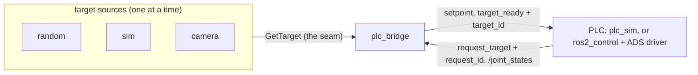

# plc_seam: ROS 2 next to a PLC that owns motion

`plc_seam` shows one way to put ROS 2 next to a programmable logic controller (PLC) that
already owns a machine's motion and safety. ROS answers one question per cycle ("where next?"),
and the PLC decides whether and how to move. The full cycle runs on a laptop with no PLC, and
the same stack drives a Beckhoff PLC through `ros2_control`.

It is the companion code of the ROSCon Belgium 2026 talk *The Seam Between Sim and Steel*.
It is reduced from a bin-picking cell in commissioning: names, symbols and dimensions are
neutral examples.

## Run it with no PLC

You need [pixi](https://pixi.sh). It installs ROS 2 Jazzy and every dependency from
[RoboStack](https://robostack.github.io) into the repository folder: no ROS install, no root.

```bash
git clone https://github.com/COREMATIC/ros2-plc-seam.git
cd ros2-plc-seam
pixi run demo
```

`pixi run demo` builds the workspace, then runs
`ros2 launch plc_seam bringup.launch.py source:=random`. For any other command, open a shell in
the environment with `pixi shell`, or prefix the command with `pixi run`.

You should see the cycle in the log, about one pick every 3 to 4 seconds:

```
[plc_bridge]: Target 0.559, 0.003, -0.482 m in base_link -> commanded
[plc_sim]: Pick 1 done
...
[plc_bridge]: Source exhausted; signalling the machine
```

After five picks the random source reports that it is empty. The PLC stand-in waits 3 seconds
for a "refill", acknowledges, and the cycle starts again. Open RViz with the `base_link` fixed
frame and a RobotModel display to watch the gantry move.

Already on ROS 2 Jazzy with apt? Clone the repository into a workspace's `src/`, then run
`rosdep install --from-paths src --ignore-src -y`, `colcon build` and
`source install/setup.bash`. Every command below works the same.

To play the simulator, start `source:=sim` and publish the point it should pick:

```bash
ros2 launch plc_seam bringup.launch.py source:=sim
ros2 topic pub --once /sim/target_point geometry_msgs/msg/PointStamped \
    "{header: {frame_id: base_link}, point: {x: 0.4, y: 0.3, z: -0.8}}"
```

Each point is served once: one point, one pick. Until a new point arrives, the source answers
"no valid target" and the PLC asks again every 5 seconds. Publish `x: 1.2` (outside the window)
and the PLC refuses it. The source clamps a point below its floor (`z = -1.02`) itself, before
the PLC sees it.

The working window lives in one file, [`config/envelope.yaml`](src/plc_seam/config/envelope.yaml),
in metres. The URDF joint limits, the PLC stand-in's window and the random source's ranges are
all read from it.

## How it fits together



A target source answers `GetTarget` with a point in metres. `plc_bridge` waits for the PLC to
ask, calls the source, and writes the setpoint and the handshake flags. The PLC is either
`plc_sim` or a real PLC behind `ros2_control`.

Two interfaces carry the whole system:

1. **`GetTarget`**, one small service between perception and control.
2. **A `ros2_control` binding**: joint and GPIO interfaces mapped to PLC symbols.

Two launch arguments pick the implementations. Everything else stays the same.

| Argument | Values | Default |
|---|---|---|
| `source` | `random`, `sim`, `camera` | `random` |
| `plc` | `sim` (a ROS node plays the PLC), `ads` (a Beckhoff PLC over ADS) | `sim` |

## 1. The seam: one service, three sources

[`GetTarget.srv`](src/plc_seam_interfaces/srv/GetTarget.srv) has an empty request. The response
holds a `PointStamped`, `success` and `source_exhausted`. Three nodes serve it, and the caller
cannot tell them apart:

| Source | Node | Where the point comes from |
|---|---|---|
| `random` | [`target_source_random`](src/plc_seam/plc_seam/target_source_random.py) | `random.uniform()` inside the working envelope |
| `sim` | [`target_source_sim`](src/plc_seam/plc_seam/target_source_sim.py) | The latest point a simulator published on `sim/target_point` |
| `camera` | [`target_source_camera`](src/plc_seam/plc_seam/target_source_camera.py) | A depth detection, transformed into `base_link` |

The cell this comes from used a scripted stub that returns fixed points. Here the stub returns
random points, so you can see the machine move.

Because the seam came first, adopting a physics simulator in the cell cost about a hundred
lines. **Design the seam before you choose the simulator.**

The camera source takes an injected detector function. It does not drive a real sensor.

## 2. The cycle: a protocol, not a topic

In most ROS systems, ROS decides when the robot moves. Here the PLC decides, so the control
flow is inverted. [`plc_bridge_node.py`](src/plc_seam/plc_seam/plc_bridge_node.py) implements it:

1. The PLC adds one to `request_id` and raises `request_target`.
2. The bridge sees the **rising edge** and calls `get_target` asynchronously. One edge, one
   request: a level trigger would flood the source.
3. The bridge converts the point to millimetres and publishes it to the position command
   interfaces.
4. On the next cycle, the bridge raises `target_ready` and writes `target_id`, the number of
   the request it answers, in one message. The PLC accepts the target only when `target_id`
   equals its own `request_id`; it checks the setpoint against its working window, drops
   `request_target` and moves. The bridge then clears `target_ready`.
5. If the source is empty, the bridge raises `source_empty` instead. It clears it only when the
   PLC acknowledges with `empty_ack`.

Each signal has exactly one writer: the PLC writes `request_target`, `request_id`, `empty_ack`,
`picking` and `placing`; ROS writes `target_ready`, `target_id` and `source_empty`.

The request number is what makes the answer safe on a real PLC. The setpoint and the flag go to
two different controllers, so nothing guarantees which one the PLC sees first. If the flag came
first with the previous setpoint still in place, or an answer arrived late for a request the PLC
already gave up on, the machine could move to the wrong place. With the number, the PLC ignores
any flag that does not answer the request it is waiting on.

Three things surprise people:

- **Booleans cross `ros2_control` as `float64`.** The bridge compares against `1.0`.
- **ROS has no primitive for "the machine just asked a question".** You write the edge detector.
- **Everything is `call_async` with a done callback.** A blocking call in this path stalls the
  GPIO stream that drives it.

[`plc_sim.py`](src/plc_seam/plc_seam/plc_sim.py) plays the PLC's side of the same protocol. Read
it as a specification for the PLC program:

- It accepts a target only when `target_id` matches the number of the request it raised.
- It refuses a setpoint outside its own working window and asks again, so the PLC keeps the
  last word.
- It has a request watchdog: with no valid answer within 5 seconds, it drops the request and
  asks again. The machine waits; it never moves on a guess.

## 3. The binding: a PLC as a ros2_control hardware interface

[`plc_ros2_control.xacro`](src/plc_seam/urdf/plc_ros2_control.xacro) maps ROS interfaces to PLC
symbols:

- position **state** interfaces: symbols holding measured axis positions, in metres;
- position **command** interfaces: symbols the PLC reads as setpoints, in millimetres;
- boolean process signals: `gpio` interfaces, read and written by `GpioCommandController`.

Two xacro macros keep the repetition out, so a new PLC signal is one line. The hardware plugin
is b»robotized's open-source
[`beckhoff_ads_driver`](https://github.com/b-robotized/beckhoff_ads_driver). Its parameters are
network settings, not motor gains.

[`controllers.yaml`](src/plc_seam/config/controllers.yaml) runs three controllers:
`ForwardCommandController` for setpoints, `GpioCommandController` for the handshake, and
`JointStateBroadcaster` for TF, RViz and any simulator. There is no trajectory controller and no
motion planner: the PLC already plans the motion.

The launch file activates the three controllers in one switch (`--activate-as-group`). One by
one, the handshake can start before the setpoint controller exists, and the first setpoint never
reaches the PLC.

## Connect a Beckhoff PLC

`plc:=ads` replaces `plc_sim` with `ros2_control_node`, the ADS driver and the three controllers.

1. Fetch the driver and build the workspace. The script clones the driver at a pinned commit
   and applies the fixes in [`patches/`](patches/beckhoff_ads_driver/) (see the known issue
   below).

   ```bash
   pixi run fetch-ads-driver    # clones into src/
   pixi run build
   ```

   With apt, run `tools/fetch_ads_driver.sh` instead: it clones next to the repository, in the
   workspace's `src/`. Then run `rosdep install` and `colcon build` again.

2. On the PLC, declare the symbols of [`plc_ros2_control.xacro`](src/plc_seam/urdf/plc_ros2_control.xacro)
   in `MAIN` or a global variable list (GVL). Symbolic access over ADS does not reach variables
   inside function blocks: mirror them into a GVL.
3. On the PLC, add a route to this computer's AMS Net ID.
4. Implement the PLC side of the handshake, as `plc_sim.py` does: add one to the request
   number on each new request, and accept a target only when `target_id` matches it.
5. Launch:

   ```bash
   ros2 launch plc_seam bringup.launch.py plc:=ads \
       plc_ip_address:=192.168.0.10 plc_ams_net_id:=192.168.0.10.1.1 \
       local_ams_net_id:=192.168.0.20.1.1
   ```

> **Known issue on Jazzy.** The driver at commit `5aa1f59` (the head of `rolling` on
> 22 November 2026) crashes with a segmentation fault right after it connects. It releases its
> symbol handles as soon as it takes them, so the first read fails, and the error log uses a
> clock that was never created. It also does not recover from an ADS error on its own. The
> fixes are in [`patches/beckhoff_ads_driver/`](patches/beckhoff_ads_driver/), and
> `tools/fetch_ads_driver.sh` applies them. They are being proposed upstream.

## Units

Everything on the ROS side is in metres (REP 103). The PLC reads setpoints in millimetres.
[`units.py`](src/plc_seam/plc_seam/units.py) converts once, at the boundary: in
`target_source_camera.py` on the way in, and in `plc_bridge_node.py` on the way out. A
`ros2_control` interface has no unit, so the symbol name carries it (`MAIN.lrAxisX_m`).

## Tests

```bash
pixi run test
```

With apt: `colcon test --packages-select plc_seam && colcon test-result --verbose`.

- [`test_target_source_contract.py`](src/plc_seam/test/test_target_source_contract.py) runs every
  target source against the same contract: a stamped point, plausible in metres, and an
  exhausted source that says so. It also fails when a new source has no test. Interchangeable
  sources hide each other's defects, so the seam gets its own test.
- [`test_plc_sim.py`](src/plc_seam/test/test_plc_sim.py) checks the PLC stand-in's side of the
  handshake: a full cycle, a refused setpoint, an empty source, the watchdog.

## Layout

```
src/
  plc_seam_interfaces/          the seam: srv/GetTarget.srv
  plc_seam/
    plc_seam/
      plc_bridge_node.py        the machine-initiated cycle
      plc_sim.py                a PLC stand-in that plays the handshake
      handshake.py              the GPIO names and topics both sides share
      target_source_random.py   ┐
      target_source_sim.py      ├ three implementations of one service
      target_source_camera.py   ┘
      units.py                  metres inside, millimetres at the boundary
      envelope.py               the working window, from config/envelope.yaml
    config/controllers.yaml     three controllers, no planner
    config/envelope.yaml        the working window, in metres: the one definition
    urdf/                       a neutral gantry and the PLC binding macros
    launch/bringup.launch.py    same stack, any source, sim or real PLC
    test/                       the contract test and the PLC stand-in test
pixi.toml, pixi.lock            ROS 2 Jazzy and the tools, from RoboStack
patches/beckhoff_ads_driver/    fixes for the ADS driver on Jazzy
tools/fetch_ads_driver.sh       fetches the driver at a pinned commit and applies them
```

## Status

This is reference code, not a product. It is tested on ROS 2 Jazzy, on Linux x86-64, both with
pixi and with apt. With `plc:=sim`, the whole cycle runs. With `plc:=ads`, it is tested against
an ADS test server with the patched driver, not against a physical PLC. The pixi lockfile also
covers macOS, Windows and Linux ARM; those platforms are not tested yet, and
`fetch-ads-driver` needs bash (Linux, macOS).

## Credits and license

The `ros2_control` binding runs on [`beckhoff_ads_driver`](https://github.com/b-robotized/beckhoff_ads_driver)
by b»robotized, presented at ROSCon 2025 ("ros2_control goes Industrial").

Copyright 2026 COREMATIC Europe. Licensed under the [Apache License 2.0](LICENSE).
